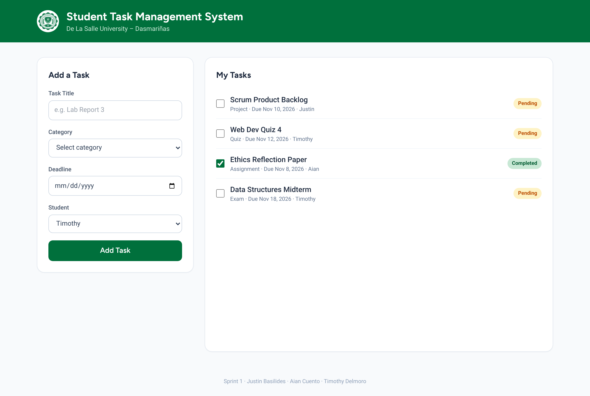
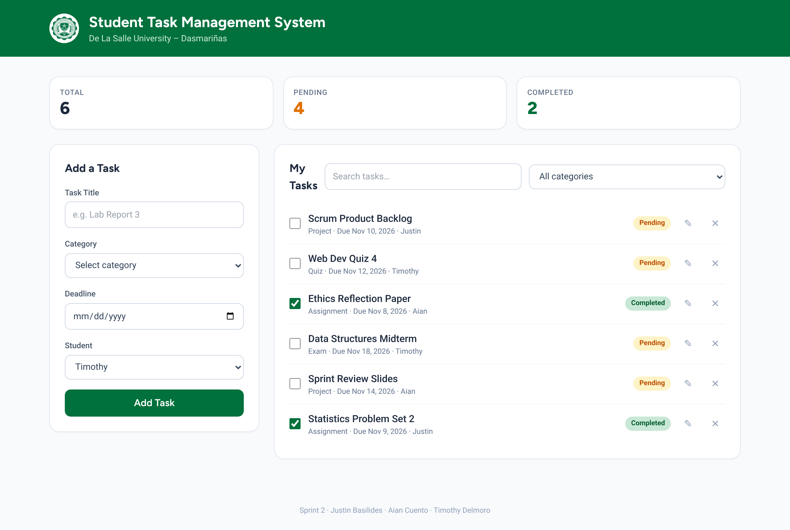
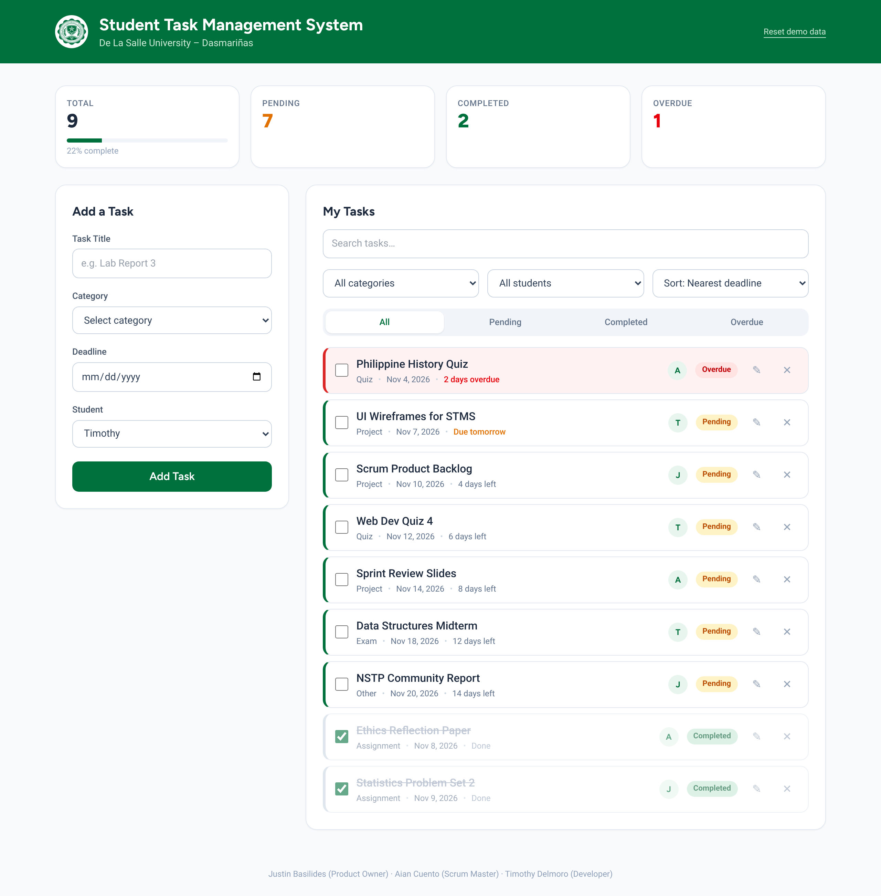

<p align="center">
  
</p>

<h1 align="center">DLSU-D Student Task Management System</h1>

<p align="center">
  A simple web app that helps students record, track, and complete their academic tasks.<br/>
  <b>Enabling Assessment 6 — Agile Software Development Using the Scrum Framework</b>
</p>

---

## Quick Start

1. Clone or download this repository.
2. Open the folder in **VS Code**.
3. Open `index.html` in a browser (or use the **Live Server** extension).

No installation needed — Tailwind CSS and petite-vue load from a CDN.

| | |
|---|---|
| **Languages** | HTML, CSS, JavaScript |
| **Libraries** | Tailwind CSS (styling), petite-vue (reactivity) |
| **Fonts** | Figtree (headings), Roboto (body) |
| **Storage** | Browser Local Storage (no database) |
| **Data** | Hardcoded sample tasks for Justin, Aian, and Timothy |

## Contents

1. [Product Vision](#1-product-vision)
2. [Scrum Team](#2-scrum-team)
3. [Product Backlog](#3-product-backlog)
4. [Definition of Done](#4-definition-of-done)
5. [Acceptance Criteria](#5-acceptance-criteria)
6. [Sprint 1 — Basic Application](#6-sprint-1--basic-application)
7. [Sprint 2 — System Enhancement](#7-sprint-2--system-enhancement)
8. [Final Sprint — Polish & Remaining Backlog](#8-final-sprint--polish--remaining-backlog)
9. [Software Testing](#9-software-testing)
10. [Sprint Retrospective](#10-sprint-retrospective)
11. [Branches](#branches)
12. [Project Structure](#project-structure)

## 1. Product Vision

> "Our goal is to develop a simple and accessible Student Task Management System that helps DLSU-D students organize academic activities, monitor deadlines, and manage their task completion efficiently."

## 2. Scrum Team

| Member | Scrum Role | Responsibilities | Git Branch |
|---|---|---|---|
| **Justin Basilides** | Product Owner | Product vision, user stories, backlog priority, acceptance of features, sample data | `justin` |
| **Aian Cuento** | Scrum Master | Facilitates Scrum events, removes impediments, CSS design & layout, Scrum records | `aian` |
| **Timothy Delmoro** | Developer | HTML structure, JavaScript functionality, integration, testing | `tim` |

> With only three members, the Product Owner and Scrum Master also helped as Developers. All code was reviewed by at least one other member before merging.

## 3. Product Backlog

Priority guide: **High** = essential · **Medium** = improves usability · **Low** = can wait for later Sprints.

| ID | User Story | Priority | Sprint |
|---|---|---|---|
| US01 | As a student, I want to **add a new academic task** so that I can record my responsibilities. | High | 1 |
| US02 | As a student, I want to **specify a deadline** so that I can monitor due dates. | High | 1 |
| US03 | As a student, I want to **categorize tasks** so that I can organize my activities. | High | 1 |
| US04 | As a student, I want to **view all my tasks** so that I can monitor my workload. | High | 1 |
| US05 | As a student, I want to **mark tasks as completed** so that I can track my progress. | High | 1 |
| US06 | As a student, I want to **edit task information** so that I can correct or update details. | Medium | 2 |
| US07 | As a student, I want to **delete tasks** so that I can remove unnecessary records. | Medium | 2 |
| US08 | As a student, I want to **search for tasks** so that I can easily find specific activities. | Medium | 2 |
| US09 | As a student, I want to **filter tasks by category** so that I can view related activities. | Medium | 2 |
| US10 | As a student, I want to **see the number of pending tasks** so that I can monitor my workload. | Medium | 2 |
| US11 | As a student, I want **completed tasks to be visually distinguished** so that I can identify finished activities. | Low | Final |
| US12 | As a student, I want my tasks to **remain saved after closing the browser** so that I do not lose my records. | High | 2 |
| US13 | As a student, I want to **sort tasks by nearest deadline** so that I can work on urgent tasks first. | Medium | Final |
| US14 | As a student, I want **overdue tasks to be highlighted** so that I do not miss late submissions. | Medium | Final |
| US15 | As a student in a group, I want to **filter tasks by member** so that I can see who is responsible for each task. | Low | Final |

## 4. Definition of Done

A backlog item is **Done** when:

1. The functionality is implemented.
2. The code is integrated into the application.
3. The feature has been tested.
4. It works according to its requirements.
5. No critical errors remain.
6. The code was reviewed by at least one other member.
7. It does not break previously completed features.

## 5. Acceptance Criteria

| User Story | Accepted when… |
|---|---|
| **US01** Add task | User can enter a title, select a category, set a deadline, and click **Add Task** · the new task appears in the list · submission is blocked when required fields are empty |
| **US02** Deadline | A date picker is available · the deadline is shown on each task · a task cannot be added without a deadline |
| **US03** Category | Category dropdown has Assignment, Project, Quiz, Exam, Other · the selected category is shown on the task |
| **US05** Complete task | Ticking the checkbox changes status to **Completed** · unticking returns it to **Pending** |
| **US06** Edit task | Clicking ✎ loads the task into the form · **Save Changes** updates the task · **Cancel** discards edits |
| **US07** Delete task | Clicking ✕ removes only the selected task · the counters update |
| **US08** Search | Typing in the search box shows only tasks whose title matches (case-insensitive) |
| **US09** Filter | Choosing a category shows only tasks in that category · "All categories" shows everything |
| **US10** Statistics | Pending and completed counts are always correct after add / edit / delete / complete |
| **US12** Persistence | Tasks remain after refreshing or reopening the browser |

## 6. Sprint 1 — Basic Application

**Sprint Goal:** *Develop a basic Student Task Management System that allows students to add, categorize, display, and complete academic tasks.*

**Timebox:** 60 minutes · **Branch:** [`sprint-1`](https://github.com/eximno/student-task-management-system/tree/sprint-1)

### Sprint Backlog

| ID | Development Task | Expected Output | Owner |
|---|---|---|---|
| US01 | Create an HTML form for adding tasks | Functional task input form | Timothy |
| US02 | Add a deadline input field | Date selection functionality | Timothy |
| US03 | Add a task category dropdown | Task categorization | Timothy |
| US04 | Display all added tasks | Dynamic task list | Timothy · Aian (layout) |
| US05 | Add a task completion feature | Status update functionality | Timothy |

### Daily Scrum

| Member | Accomplished | Next | Impediments |
|---|---|---|---|
| Timothy | Set up `index.html`, `script.js`, and petite-vue | Task list and completion checkbox | None |
| Aian | Defined green theme and form/card styles | Badge and checkbox styles | Fonts not loading at first — fixed the Google Fonts link |
| Justin | Wrote backlog and hardcoded sample tasks | Prepare Sprint 1 review checklist | None |

### Sprint Review

| User Story | Expected Functionality | Status |
|---|---|---|
| US01 | Add a task | ✅ Accepted |
| US02 | Set a deadline | ✅ Accepted |
| US03 | Categorize a task | ✅ Accepted |
| US04 | Display tasks | ✅ Accepted |
| US05 | Complete a task | ✅ Accepted |

**Carried over:** none. Tasks are lost on refresh → US12 moved to the top of Sprint 2.



## 7. Sprint 2 — System Enhancement

**Sprint Goal:** *Improve the Student Task Management System by implementing editing, deleting, searching, filtering, and data persistence functionalities.*

**Timebox:** 60 minutes · **Branch:** [`sprint-2`](https://github.com/eximno/student-task-management-system/tree/sprint-2)

### Sprint Backlog

| ID | Development Task | Expected Output | Owner |
|---|---|---|---|
| US06 | Implement task editing | Updated task information | Timothy |
| US07 | Implement task deletion | Removed task record | Timothy |
| US08 | Implement task searching | Search functionality | Timothy |
| US09 | Implement task filtering | Filtered task list | Timothy |
| US10 | Display task statistics | Pending and completed counts | Aian (cards) · Timothy |
| US12 | Implement JavaScript Local Storage | Persistent task records | Timothy |

### Daily Scrum

| Member | Accomplished | Next | Impediments |
|---|---|---|---|
| Timothy | Local Storage, edit and delete | Search and category filter | Edited task stayed in the form after deletion — fixed by resetting the form |
| Aian | Statistics cards and icon buttons | Responsive check on mobile | Delete hover color was overridden by the base button style — fixed with a `.danger` class |
| Justin | Added more sample tasks | Retest Sprint 1 features with new code | None |

### Sprint Review

| User Story | Expected Functionality | Status |
|---|---|---|
| US06 | Edit a task | ✅ Accepted |
| US07 | Delete a task | ✅ Accepted |
| US08 | Search tasks | ✅ Accepted |
| US09 | Filter by category | ✅ Accepted |
| US10 | Pending / completed counts | ✅ Accepted |
| US12 | Data persists after refresh | ✅ Accepted |

**Carried over:** US11 (Low) was not selected — kept in the Product Backlog for the Final Sprint.



## 8. Final Sprint — Polish & Remaining Backlog

**Sprint Goal:** *Complete the remaining backlog items, improve usability, and fully test the application before submission.*

**Timebox:** 60 minutes · **Branch:** [`main`](https://github.com/eximno/student-task-management-system/tree/main)

### Sprint Backlog

| ID | Development Task | Expected Output | Owner |
|---|---|---|---|
| US11 | Style completed tasks differently | Faded, strikethrough completed tasks | Aian |
| US13 | Add sort options | Nearest deadline / Title / Recently added | Timothy |
| US14 | Highlight overdue tasks | Red row, overdue badge and counter | Timothy · Aian |
| US15 | Filter by student | Member dropdown filter | Timothy |
| — | Inline validation, status tabs, toast messages, reset demo data | Better usability | Timothy |
| — | Full regression test | Completed testing table | Justin |

### Daily Scrum

| Member | Accomplished | Next | Impediments |
|---|---|---|---|
| Timothy | Sorting, overdue logic, student filter, status tabs | Inline validation and toasts | Date comparison was off by timezone — fixed by comparing local midnight |
| Aian | Completed and overdue row styles, progress bar | Final responsive check | None |
| Justin | Wrote test cases | Run full test and accept stories | None |

### Sprint Review

| User Story | Expected Functionality | Status |
|---|---|---|
| US11 | Completed tasks visually distinguished | ✅ Accepted |
| US13 | Sort by nearest deadline | ✅ Accepted |
| US14 | Overdue tasks highlighted | ✅ Accepted |
| US15 | Filter by member | ✅ Accepted |

**Carried over:** none — Product Backlog complete.



### Initial vs. Improved Version

| Sprint 1 | Final |
|---|---|
| Add, categorize, list, complete | + Edit, delete, search, filter, sort |
| Data lost on refresh | Saved in Local Storage |
| Single error message | Inline validation per field |
| No statistics | Total, pending, completed, overdue + progress bar |
| Completed tasks look the same | Faded + strikethrough; overdue tasks in red |

## 9. Software Testing

| # | Test Case | Expected Result | Actual Result | Status |
|---|---|---|---|---|
| 1 | Add a task with complete information | Task is added successfully | Task appears in the list | ✅ Pass |
| 2 | Add a task without a title | System prevents submission | "Task title is required." shown | ✅ Pass |
| 3 | Add a task without a deadline | Appropriate validation shown | "Please set a deadline." shown | ✅ Pass |
| 4 | Select a task category | Correct category is displayed | Category shown on the task | ✅ Pass |
| 5 | Mark a task as completed | Task status changes | Badge changes to Completed | ✅ Pass |
| 6 | Edit an existing task | Task information is updated | Changes saved and displayed | ✅ Pass |
| 7 | Delete a task | Selected task is removed | Only that task is removed | ✅ Pass |
| 8 | Search for a task | Matching task is displayed | Only matching tasks shown | ✅ Pass |
| 9 | Filter tasks by category | Only matching tasks are displayed | Only that category shown | ✅ Pass |
| 10 | Refresh the browser | Saved tasks remain available | Tasks loaded from Local Storage | ✅ Pass |
| 11 | Sort by nearest deadline | Earliest deadline first | Pending tasks ordered by date | ✅ Pass |
| 12 | Task with a past deadline | Highlighted as overdue | Red row + Overdue badge | ✅ Pass |
| 13 | Filter by student | Only that member's tasks | Only that member's tasks shown | ✅ Pass |

### How Local Storage Works

Tasks are saved in the browser under the key `dlsud-stms-tasks`.

```js
// Save — called after every add, edit, delete, or complete
localStorage.setItem('dlsud-stms-tasks', JSON.stringify(tasks))

// Load — on page start; falls back to the hardcoded sample tasks
const tasks = JSON.parse(localStorage.getItem('dlsud-stms-tasks')) ?? SEED_TASKS
```

Local Storage only stores strings, so the task array is converted to JSON when saving and parsed back when loading. Data stays until the browser storage is cleared.

## 10. Sprint Retrospective

| What Went Well | What Needs Improvement | Action Plan |
|---|---|---|
| Clear backlog priorities made Sprint Planning fast | Sprint 1 had no persistence, so testing data was lost on refresh | Pick data-related stories earlier |
| One branch per member avoided merge conflicts | Some UI bugs were found only during review | Review each other's branch before merging |
| Petite-vue kept the JavaScript short and readable | Date/timezone handling was tricky | Add test cases for edge dates (today, past, tomorrow) |
| Daily Scrum surfaced blockers quickly | Small team meant PO and SM also coded | Keep roles clear during events even when sharing work |

**Guide answers (team):**
- **Were backlog items realistic?** Yes — all selected items were finished in each Sprint.
- **Communication?** Good; blockers were raised in the Daily Scrum and fixed the same session.
- **Unfinished tasks?** US11 was kept in the Product Backlog after Sprint 2 and finished in the Final Sprint.
- **Changes from feedback?** Inline validation and overdue highlighting were added after the Sprint 2 review.

## Branches

Each Sprint is preserved as its own branch so the product increment can be compared version by version.

| Branch | Contents |
|---|---|
| `main` | **Final Sprint** — complete, tested product |
| `sprint-2` | Sprint 2 increment (edit, delete, search, filter, stats, Local Storage) |
| `sprint-1` | Sprint 1 increment (add, categorize, list, complete) |
| `justin` | Product Owner work — backlog, acceptance criteria, reviews, sample data |
| `aian` | Scrum Master work — CSS design, Scrum event records |
| `tim` | Developer work — HTML structure and JavaScript features |

Workflow: members work on their own branch → merge into the current `sprint-*` branch after review → the final increment is merged into `main`.

## Project Structure

```
StudentTaskManagement/
├── index.html      # Structure and UI (Tailwind classes, petite-vue bindings)
├── style.css       # Custom components, theme, task states
├── script.js       # App logic, validation, Local Storage
├── assets/logo.png
└── docs/screenshots/
```
